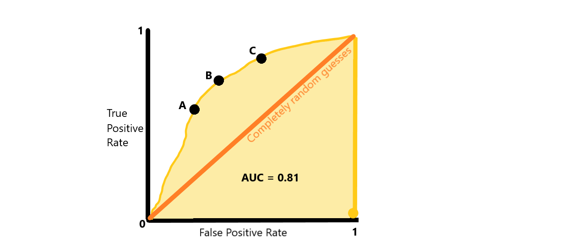

# Fundamentals

Data science provides a framework for extracting insight, making predictions and supporting decision-making from data. Although the field contains a wide range of specialised methods and techniques, most analytical approaches are built upon a small number of fundamental concepts. Understanding these core ideas is essential before progressing to more advanced modelling, machine learning or artificial intelligence applications. At a high level, data science can be viewed as the process of learning patterns from data. Some techniques focus on predicting known outcomes, whilst others seek to uncover hidden structures and relationships. The choice of method depends on the nature of the problem being addressed, the available data and the desired outcome. Before exploring specific modelling techniques, it is important to understand how machine learning models learn from data and the challenges that can arise when attempting to generalise patterns beyond the information used to train them.

## Overfitting vs Underfitting

One of the primary objectives of any predictive model is to identify patterns that generalise beyond the training data. A useful model should perform well not only on the data it has already seen, but also on new observations that were not available during model development. Two common problems that prevent this are **underfitting** and **overfitting**.

**Underfitting** occurs when a model is too simple to capture the underlying structure within the data. The model fails to learn important relationships and consequently performs poorly on both training and unseen data. A linear model applied to a highly non-linear problem is a common example of underfitting.

**Overfitting** occurs when a model becomes overly specialised to the training data. Rather than learning general patterns, the model memorises noise, random fluctuations and observations that are not representative of future data. Whilst the model may achieve excellent performance on the training dataset, performance often deteriorates significantly when applied to new observations.

A useful way of visualising this concept is to consider fitting a curve through a collection of points. An underfit model draws a very simple line that fails to capture the overall trend. An overfit model produces a highly complex curve that bends excessively to pass through every point. Ideally, a model should strike a balance between these extremes, capturing genuine patterns whilst ignoring random noise.

Several techniques can help reduce overfitting, including:

- Increasing the amount of training data.
- Reducing model complexity.
- Feature selection.
- Cross-validation.
- Regularisation techniques such as Lasso and Ridge regression.

The overall goal is to build a model that captures meaningful relationships whilst remaining robust when applied to unseen data.

## Supervised vs Unsupervised Learning

Most machine learning techniques can be categorised as either **supervised** or **unsupervised** learning. The distinction revolves around whether the data contains a known outcome variable that the model attempts to learn.

In **supervised learning**, historical examples contain both input variables and the desired output. The model learns the relationship between them and can subsequently predict outcomes for new observations. For example, a model may be trained on:

| Income | Age | Loan Approved |
|----------|----------|----------|
| £40,000 | 30 | Yes |
| £25,000 | 21 | No |
| £65,000 | 45 | Yes |

Because the outcome ("Loan Approved") is known, the model can learn patterns associated with approval decisions.

In **unsupervised learning**, no target variable exists. Instead, the goal is to identify natural structures, patterns, groupings, or relationships within the data itself. For example, customer transaction records might be analysed to identify groups of customers who exhibit similar purchasing behaviour without any predefined labels.

A useful rule of thumb is:

- Supervised learning predicts known outcomes.
- Unsupervised learning discovers hidden patterns.

## Supervised

Supervised learning is the most widely used area of machine learning and forms the foundation of many predictive analytics solutions. The objective is to learn a mapping between input variables (features) and an output variable (target). Once trained, the model can be used to generate predictions for previously unseen observations. The two primary categories of supervised learning are classification and regression.

### Classification

Classification models are used when the outcome variable represents a *category* rather than a *continuous* value. The objective is to assign observations into predefined classes based on the characteristics contained within the input variables. During training, the algorithm learns patterns that distinguish one class from another. When presented with a new observation, it evaluates these characteristics and determines which class the observation is most likely to belong to. 

Common applications include:

- Fraud detection.
- Disease diagnosis.
- Customer churn prediction.
- Email spam filtering.
- Sentiment analysis.

For example, if I was wanting to predict whether a customer would leave a subscription service like Netflix and I had the data shown here:

| Age | Monthly Spend | Tenure (Months) | Status |
|----------|----------|----------|----------|
| 25 | £20 | 3 | Leave |
| 43 | £55 | 19 | Active |
| 29 | £23 | 5 | Leave |
| 88 | £44 | 49 | Active |

The input variables (features) would be the age, spend and tenure whilst the target variable (class) would be their status. Using this historical data, the model may learn that individuals that spend little money and have a reduced tenure are likely to leave and therefore this could be used to help navigate efforts and expenditure to improve customer retention. This method ultimately allows the assignment of a new observation/value/data point into a category that best describes its characteristics, based upon historical learning.

The output of a classification model is typically either:

- A predicted class label.
- A probability associated with each class.

The predicted class label is exactly what was shown above, the output of the classification in a simple format. E.g. if we had a new observation where a customer spent £10 a month and had a tenure of 4 months, the classification would likely be that they might leave. Underneath this decision is the probability that it belongs to this particular classification class, which is what the other output can be. For example it might be 85% likely that they belong to the 'Left' category rather than the 'Active' category. If there are more than two categories, e.g. no longer a binary, this can become increasingly important to gather understanding as to how likely it is to belong to that class. Should it be 90% that someone may leave for example, they may be a customer to target efforts to retain, rather than someone that is 51% to leave. The probability associated with each class offers great insight into how well the new observations falls into the category assigned.

Common classification algorithms include:

- Logistic Regression
- Decision Trees
- Random Forests
- Support Vector Machines (SVM)
- Gradient Boosting
- Neural Networks

Model performance is often evaluated using metrics such as **accuracy**, **precision**, **recall**, **F1-score**, and the **Area Under the Receiver Operating Characteristic Curve (AUC-ROC)**. Each metric measures a different aspect of performance and should be selected based on the objectives of the problem being solved. Whilst accuracy is intuitive and easy to understand, relying on a single metric can be misleading, particularly when classes are imbalanced. For this reason, multiple evaluation metrics are typically considered together. To understand these metrics, I will first introduce the concept of a **confusion matrix**.

### Confusion Matrix

A confusion matrix summarises the predictions made by a classification model against the true outcomes.

|                      | Actual Positive | Actual Negative |
|----------------------|----------------|----------------|
| Predicted Positive   | True Positive (TP) | False Positive (FP) |
| Predicted Negative   | False Negative (FN) | True Negative (TN) |

The four possible outcomes are:
- **True Positive (TP)**: The model correctly predicts the positive class.
- **True Negative (TN)**: The model correctly predicts the negative class.
- **False Positive (FP)**: The model predicts a positive outcome when none exists.
- **False Negative (FN)**: The model predicts a negative outcome when the true outcome is positive.

All of the evaluation metrics discussed below are derived from these four values.

```{mermaid}
flowchart TD

    CM[Confusion Matrix]

    CM --> TP[True Positive]
    CM --> FP[False Positive]
    CM --> FN[False Negative]
    CM --> TN[True Negative]

    TP --> P["Precision = TP / (TP + FP)"]
    TP --> R["Recall = TP / (TP + FN)"]

    P --> F1[F1 Score]
    R --> F1

    TP --> ACC[Accuracy]
    TN --> ACC
```


### Accuracy

Accuracy measures the proportion of all predictions that were correct.

$$
Accuracy = \frac{TP + TN}{TP + TN + FP + FN}
$$

For example, if a model correctly predicts 950 out of 1,000 observations:

$$
Accuracy = \frac{950}{1000} = 95\%
$$

Accuracy is simple to understand but can be highly misleading when working with imbalanced datasets. Consider a fraud dataset where only 1% of transactions are fraudulent. A model that predicts "Not Fraud" for every transaction would achieve 99% accuracy despite identifying no fraudulent transactions at all. Whilst the accuracy appears excellent, the model would be practically useless. As a result, accuracy should rarely be used in isolation.

### Precision

Precision evaluates how reliable positive predictions are. It answers the question *Of all the observations predicted to belong to the positive class, how many actually were positive?*

The formula is:

$$
Precision = \frac{TP}{TP + FP}
$$

Suppose a fraud model identifies 100 transactions as fraudulent:
- 80 are genuinely fraudulent.
- 20 are legitimate transactions incorrectly flagged.

The precision would be:

$$
Precision = \frac{80}{80+20}=0.80
$$

or **80%**.

High precision indicates that when the model predicts a positive case, it is usually correct. Precision is often particularly important when false positives are costly. Examples include:

- Incorrectly flagging legitimate banking transactions.
- Wrongly accusing customers of fraudulent behaviour.
- Sending unnecessary medical referrals.

### Recall (Sensitivity)

Recall measures the model's ability to identify all positive cases. It answers the question *Of all the truly positive observations, how many did the model successfully identify?*

The formula is:

$$
Recall = \frac{TP}{TP + FN}
$$

Suppose 100 fraudulent transactions actually occurred:

- The model successfully detects 90.
- The model misses 10.

The recall would be:

$$
Recall = \frac{90}{90+10}=0.90
$$

or **90%**.

High recall indicates that very few positive cases are missed. Recall is particularly important when false negatives carry significant consequences, such as:

- Disease diagnosis.
- Fraud detection.
- Security threat identification.
- Equipment failure prediction.

In these situations, missing a genuine positive case may be far more serious than generating additional false alarms.

### Precision vs Recall

There is often a trade-off between precision and recall. A model can achieve very high recall simply by predicting many observations as positive. However, doing so typically increases the number of false positives and reduces precision. Conversely, a model can achieve very high precision by only making positive predictions when it is extremely confident. However, this often causes genuine positive cases to be missed, reducing recall. The appropriate balance depends on the business problem. A few use cases where you'd prioritise one over the other I've listed below.

| Use Case | More Important Metric |
|-----------|-----------|
| Disease Screening | Recall |
| Terrorism Detection | Recall |
| Fraud Monitoring | Often Recall |
| Spam Detection | Often Precision |
| Product Recommendation | Precision |

### F1-Score

The F1-score combines precision and recall into a single metric. Rather than calculating a simple average, it uses the **harmonic mean**, which penalises situations where one metric is much lower than the other.

The formula is:

$$
F1 = 2 \times \frac{Precision \times Recall}{Precision + Recall}
$$

Suppose:

- Precision = 0.80
- Recall = 0.90

Then:

$$
F1 = 2 \times \frac{0.80 \times 0.90}{0.80 + 0.90}
= 0.847
$$

or approximately **84.7%**.

The F1-score is particularly useful when:

- Classes are imbalanced.
- Both false positives and false negatives are important.
- A single performance measure is required.

Because it balances precision and recall, it often provides a more realistic assessment than accuracy alone. It is worth noting that when an F1-score is reported, it may represent an aggregation of multiple class-specific F1-scores. A **Macro F1-score** gives equal importance to every class by averaging the F1-score of each class, regardless of how frequently that class occurs in the data. In contrast, a **Weighted F1-score** gives greater influence to classes with more observations. As a result, Macro F1 is often a better reflection of how consistently a model performs across all classes, while Weighted F1 better reflects overall performance on the dataset as a whole. When classes are imbalanced, Weighted F1 will typically be higher if the model performs well on the majority classes but struggles on the minority classes.

### ROC Curve

Unlike Accuracy, Precision, Recall, and F1-score, which are calculated from a confusion matrix at a single classification threshold, ROC analysis evaluates model performance across all possible thresholds. The ROC curve plots the True Positive Rate (Recall) against the False Positive Rate, allowing analysts to assess how effectively the model discriminates between classes irrespective of the threshold chosen. Most classification models produce probabilities rather than directly assigning classes.

For example:

| Customer | Probability of Leaving |
|-----------|-----------|
| A | 0.92 |
| B | 0.74 |
| C | 0.48 |
| D | 0.21 |

To convert probabilities into classifications, a threshold is typically selected.

For example:

```text
Probability > 0.5  → Leave
Probability ≤ 0.5  → Remain
```

However, changing this threshold affects model performance. The **Receiver Operating Characteristic (ROC) Curve** visualises model performance across all possible thresholds.

The graph plots:

- **True Positive Rate (Recall)** on the y-axis.
- **False Positive Rate** on the x-axis.

Where:

$$
False\ Positive\ Rate = \frac{FP}{FP + TN}
$$

An ideal model would achieve:

```text
True Positive Rate = 1
False Positive Rate = 0
```

which corresponds to the upper-left corner of the ROC space.

### AUC-ROC

The **Area Under the ROC Curve (AUC-ROC)** summarises the ROC curve as a single value between 0 and 1.

Interpretation is often:

| AUC | Interpretation |
|------|------|
| 0.50 | No better than random guessing |
| 0.60 - 0.70 | Poor |
| 0.70 - 0.80 | Fair |
| 0.80 - 0.90 | Good |
| 0.90 - 1.00 | Excellent |

An AUC of 0.85 can be interpreted as *If we randomly select one positive and one negative observation, there is an 85% probability that the model will assign a higher score to the positive observation than the negative observation.* One advantage of AUC-ROC is that it evaluates a model's ability to distinguish between classes across all possible classification thresholds. Rather than measuring performance at a single cut-off value, AUC assesses how effectively the model ranks positive observations above negative observations. As a result, AUC often provides a more robust measure of classification performance, particularly when decision thresholds may change depending on the context of the problem. 



Above I have created a graph that shows the AUC-ROC visually, and within this I have labelled 3 points; A, B and C. These each represent a different threshold for the model, and by studying the graph you can see that they may have different impacts on the TPR and FPR of the classification. If you wanted to know which threshold is better to select, that answer can only be gathered from other selection metrics (accuracy, F1, recall and precision) as well as **the business or application tolerance of the outcome**. What I mean by this is should a false positive result be very costly or damaging, such as flagging customer transaction that are legitimate, then point A may be more favourable in terms of a threshold to choose. If false negatives (missing a true positive) are more costly however, such as diagnosis of disease, then point C may be more favourable. If they are both equally costly, then a middle ground of point B may be more favourable. This is why the context of the problem and the metrics surrounding the model at different thresholds are critical and determine what is the appropriate choice, rather than a one-size-fits-all approach.

An important distinction that I want to cement here is that an AUC of 0.5 is **not** because there is a 50/50 chance of classifying correctly. If that was the case, this would immediately break when there are more classes than a binary option, which it does not. The reason it is 0.5 for random guesses is that at any threshold, the expected TPR is equal to the expected FPR, because the diagonal line represents a classifier that cannot distinguish positive from negative examples; or in other words ***y = x***. The area beneath the diagonal therefore is:

$$
AUC = \frac{1}{2} \times 1 \times 1 = 0.5
$$

#### Multi-Class AUC-ROC: One-vs-Rest and One-vs-One

The understanding that AUC is not simply the probability of a correct classification becomes even more important when considering multi-class problems. Suppose there are four classes. Random guessing would produce an expected accuracy of only 0.25 (25%), yet the expected AUC remains 0.5. This is because AUC measures the ability to rank observations correctly rather than the proportion classified correctly at a particular threshold.

For multi-class classification, ROC curves are typically extended using either a **One-vs-Rest (OvR)** or **One-vs-One (OvO)** approach.

##### One-vs-Rest (OvR)

In the One-vs-Rest approach, each class is treated as the positive class in turn, while all remaining classes are combined into a single negative group. For a four-class problem with classes A, B, C, and D, four separate ROC curves would be calculated:

- A vs (B, C, D)
- B vs (A, C, D)
- C vs (A, B, D)
- D vs (A, B, C)

Each ROC curve produces its own AUC value, and these are commonly averaged to produce an overall multi-class AUC. An AUC of 0.85 for Class A in an OvR analysis can be interpreted as *If we randomly select one observation from Class A and one observation from any of the other classes, there is an 85% probability that the model will assign a higher score to the Class A observation.*

##### One-vs-One (OvO)

The One-vs-One approach compares every possible pair of classes separately. For four classes, this produces:

- A vs B
- A vs C
- A vs D
- B vs C
- B vs D
- C vs D

This results in:

$$
\frac{k(k-1)}{2}
$$

pairwise ROC curves, where \(k\) is the number of classes. For four classes:

$$
\frac{4(4-1)}{2} = 6
$$

ROC curves are calculated. The resulting AUC values are then averaged to provide an overall measure of performance. An AUC of 0.85 for the comparison between Classes A and B can be interpreted as *If we randomly select one observation from Class A and one observation from Class B, there is an 85% probability that the model will assign a higher score to the observation belonging to the correct class.*

The key point is that even in multi-class settings, the baseline AUC for random predictions remains 0.5 because the classifier has no ability to rank one class above another. The expected ROC curve therefore still follows the diagonal line \(y=x\), where the True Positive Rate equals the False Positive Rate across all thresholds. Accuracy changes as the number of classes increases because random guessing becomes less likely to select the correct class, whereas AUC continues to measure ranking ability rather than classification correctness.

### Choosing the Right Metric

Whilst AUC-ROC is often considered one of the most informative classification metrics, it does not replace Accuracy, Precision, Recall, or F1-score. AUC is threshold independent and measures how effectively a model separates positive and negative observations across all possible classification thresholds. In contrast, Accuracy, Precision, Recall, and F1-score are threshold-dependent metrics and evaluate performance at a specific threshold that reflects how the model will be used in practice. As a result, AUC is often used to compare model quality during development, whilst the other metrics are used to evaluate performance after a decision threshold has been selected and confirm whether it meets operational or business requirements. Ultimately, there is no universally "best" evaluation metric. The most appropriate choice depends on the problem being solved and the relative costs of different error types.

- **Accuracy** is useful when classes are balanced.
- **Precision** is important when false positives are costly.
- **Recall** is important when false negatives are costly.
- **F1-score** balances precision and recall.
- **AUC-ROC** evaluates overall classification performance across multiple decision thresholds.

In practice, it is common to review several metrics together. A model with excellent accuracy may perform poorly in terms of recall, whilst a model with excellent recall may generate too many false positives. Understanding these trade-offs within the context of the business/model application is essential when selecting and evaluating machine learning models in real-world settings.

### Regression

Regression models are used when the outcome variable is continuous.

The objective is to estimate the expected value of a target variable given a set of predictor variables.

Examples include:

- House price prediction.
- Sales forecasting.
- Demand estimation.
- Revenue prediction.
- Temperature forecasting.

Linear regression remains one of the most important and interpretable modelling techniques. The estimated coefficient for a predictor variable represents the expected change in the dependent variable for a one-unit change in that predictor whilst holding all other variables constant.

This final point is particularly important when discussing multicollinearity.

#### Multicollinearity

A key objective of regression analysis is to isolate the relationship between each independent variable and the dependent variable. However, this becomes difficult when predictor variables are highly correlated with one another.

Multicollinearity occurs when two or more independent variables contain overlapping information. Because these variables tend to move together, the model struggles to determine the unique contribution of each variable independently.

The stronger the correlation between predictors, the more difficult it becomes to estimate stable and reliable regression coefficients.

Some common consequences include:

- Large standard errors.
- Unstable coefficient estimates.
- Changes in coefficient signs.
- Reduced statistical significance.
- Difficulty interpreting predictor effects.

Importantly, multicollinearity affects interpretation much more than prediction.

##### Structural

Structural multicollinearity is introduced through the design of the model itself rather than being present within the raw data.

This frequently occurs when:

- Polynomial terms are created.
- Interaction effects are added.
- Squared or higher-order terms are included.

For example:

```text
Sales ~ Advertising + Advertising²
```

Because the squared term is derived directly from the original variable, they are inevitably highly correlated.

A common approach for reducing structural multicollinearity is **centering** continuous variables by subtracting their mean before creating higher-order terms.

##### Data

Data multicollinearity exists naturally within the dataset.

This often occurs in observational studies where related variables tend to move together.

Examples include:

- Height and weight.
- Income and education.
- House size and number of rooms.
- Population and number of businesses.

Unlike structural multicollinearity, this form reflects real-world relationships and may be more difficult to resolve.

##### Variance Inflation Factor (VIF)

The most common method for assessing multicollinearity is the **Variance Inflation Factor (VIF)**.

VIF measures how much the variance of a regression coefficient has been inflated due to correlation with other predictor variables.

Interpretation guidelines are commonly:

| VIF | Interpretation |
|------|------|
| 1 | No correlation |
| 1 - 5 | Moderate correlation |
| > 5 | Potentially problematic |
| > 10 | Severe multicollinearity |

VIF should be interpreted alongside domain knowledge, sample size and modelling objectives rather than used as a strict pass/fail threshold.

##### Required to Address?

Multicollinearity is not always a problem that must be fixed.

Whether corrective action is required depends largely on the objective of the analysis.

You may not need to address multicollinearity when:

1. The level of multicollinearity is moderate.
2. The affected variables are not central to the research question.
3. Prediction is the primary goal rather than interpretation.

One important characteristic of multicollinearity is that it does **not** typically affect:

- Overall model fit.
- R-squared.
- Prediction accuracy.
- Forecasting performance.

Instead, it primarily impacts coefficient interpretation and hypothesis testing.

When action is required, potential solutions include:

- Removing correlated variables.
- Combining variables.
- Principal Component Analysis (PCA).
- Partial Least Squares (PLS).
- Regularised regression methods such as Lasso and Ridge.

#### Regularisation

Regularisation refers to methods that deliberately constrain model complexity in order to improve generalisation performance.

The key idea is to penalise large coefficient values during model fitting. This discourages the model from becoming overly dependent on any individual predictor and helps reduce overfitting.

Two of the most common approaches are Lasso and Ridge regression.

##### Lasso (L1)

Lasso regression applies an L1 penalty to model coefficients.

The optimisation process seeks to minimise:

```text
Residual Sum of Squares + λ Σ|β|
```

A unique characteristic of Lasso is that some coefficients can be reduced exactly to zero.

This effectively performs automatic feature selection by removing variables that contribute little predictive value.

Advantages include:

- Reduces overfitting.
- Performs variable selection.
- Produces simpler, more interpretable models.

Lasso is particularly useful when datasets contain large numbers of potential predictors.

##### Ridge (L2)

Ridge regression applies an L2 penalty to model coefficients.

The optimisation objective becomes:

```text
Residual Sum of Squares + λ Σβ²
```

Unlike Lasso, Ridge rarely removes variables completely. Instead, it shrinks coefficients toward zero whilst retaining all predictors.

Advantages include:

- Handles multicollinearity effectively.
- Stabilises coefficient estimates.
- Improves prediction performance.

Ridge is often preferred when many predictors contribute useful information and there is little desire to remove variables entirely.

## Unsupervised

Unlike supervised learning, unsupervised learning seeks to identify structure within data that contains no predefined outcome variable.

These techniques are commonly used for exploratory analysis, pattern discovery, data compression and feature engineering.

### Clustering

Clustering aims to group observations that exhibit similar characteristics.

The objective is to maximise similarity within groups whilst maximising differences between groups.

Applications include:

- Customer segmentation.
- Fraud detection.
- Market analysis.
- Healthcare patient stratification.
- Geographic analysis.

Common clustering algorithms include:

- K-Means Clustering
- Hierarchical Clustering
- DBSCAN
- Gaussian Mixture Models

A retailer, for example, may use clustering to identify groups of customers with similar spending habits and subsequently tailor marketing campaigns for each segment.

### Dimensionality Reduction

Modern datasets often contain large numbers of variables.

While additional features can provide more information, they frequently introduce noise, computational complexity and multicollinearity. This phenomenon is often referred to as the "curse of dimensionality".

Dimensionality reduction techniques summarise information contained within many variables into a smaller number of components whilst preserving as much variance as possible.

Common methods include:

- Principal Component Analysis (PCA)
- t-SNE
- UMAP
- Factor Analysis

Benefits include:

- Faster model training.
- Reduced storage requirements.
- Improved visualisation.
- Reduced multicollinearity.
- Improved generalisation.

Principal Component Analysis (PCA) is particularly important because it transforms correlated variables into a set of orthogonal (uncorrelated) components that explain successively smaller proportions of variance.

### Association

Association learning focuses on identifying relationships between events, items, or behaviours that frequently occur together.

Rather than predicting an outcome, association methods reveal patterns such as:

> "If event A occurs, event B is also likely to occur."

The most well-known example is market basket analysis.

For example, a supermarket may discover that customers who purchase:

- Bread
- Butter

are also likely to purchase:

- Milk

Association rules are commonly evaluated using:

- Support
- Confidence
- Lift

These techniques are frequently used in:

- Product recommendations.
- Retail analytics.
- Website personalisation.
- Cross-selling strategies.
- Customer behaviour analysis.

Whilst association analysis is one of the simpler unsupervised techniques conceptually, it can uncover highly valuable business insights that are difficult to identify through manual analysis alone.

# R

## Linting

Linting is the essentially the process of standardising the appearance and format of code, such to flag errors that may impact the code. This is important as it reduces the likelihood of errors being introduced, prevents unintentional format changes and ensures consistency across a team of individuals. Critically, this can improve workflows as every team member follows the same set of instructions/stylistic choices, meaning when work is rotated between staff, the structure and formatting is consistent even if the subject matter is different. Ultimately, the end result is improved the efficiency of the team when transitioning to new code they may not have seen before, as the expectation of layout is similar.

### How to Lint?

In R, one simplified method of linting is to use the 'lintr' package. This package contains a variety of functions, but two that I suggest should be higher priority are:

```{r}
#| label: Lint commands
#| eval: false
lintr::lint("")
lintr::lint_package("")
```

These two functions are particularly important as they allow the linting of a (1) singular file or (2) a full package. The function `lintr::lint()` can be populated with the argument related to the specific file that you intend to lint, such as:

```{r}
#| label: Linting a file
#| eval: false
lintr::lint("my_file.R")
```

The function `lintr::lint_package()` however is useful when linting a full package, including all files related to a `golem` application. If you run:

```{r}
#| label: Linting a package
#| eval: false
lintr::lint_package()
```

from the working directory of your `golem` application, it will provide you with a file by file list of all linting errors that require amending.

### Typical Linting Errors

There are a variety of common errors that linting will identify. A few of the most frequent issues I will document here:

#### Commented code

Remove all commented code from the scripts as accidental un-commenting can have adverse impacts on the script/app.

#### Trailing whitespace

Highlight and remove all whitespace that exists after the line of code as this can impact formatting or even alter function in some settings (e.g. YAML indentation).

#### Snakecase variables

All variable names should be snakecase to ensure that variables are consistently named within a script/app and therefore prevent errors associated with capitalisation.

#### Line length

The length of the code line exceeds the accepted length and so should be separated out. This helps with readability and ensures code can be followed easily.

### Reconfiguration

One potential method to overcome a large portion of linting errors efficiently is to utilise a combinatiorial approach to read and write the file again. The `readLines()` function from base R can be used to generate a full character vector of your script. This can then be fed into the `writeLines()` function in base R, with aid from the `style_text()` function from the `styler` package to write out the file in a linted format. An example of this process would be:

```{r}
#| label: Linting rewrite
#| eval: false
original_file <- readLines("file_that_needs_linting.R")
writeLines(styler::style_text(original_file), con = "file_that_needs_linting.R")
```

The above code will take the original file that requires linting and **overwrite** the original file with the new linted version of that file. Extreme care must therefore be taken when using this approach, particularly if attempting to lint multiple files using this method, that the correct file is overwritten.

## Golem Modularisation

### Setting up Golem

A `golem` application is an R package and therefore introduces many of the distinct benefits that R packages hold over traditional R Shiny applications. One **major** benefit is the structural integrity that is developed through `golem` replicating a package arhcitecture. To initiate a golem application, the following code is required:

```{r}
#| label: Creating golem
#| eval: false
golem::create_golem("app_name")
```

This will initially create the golem application with the required starting structure and the associated name. The structure that this develops is:

```{r}
#| label: Golem structure
#| eval: false
app_name
├── DESCRIPTION
├── NAMESPACE
├── R
│   ├── app_config.R
│   ├── app_server.R
│   ├── app_ui.R
│   └── run_app.R
├── dev
│   ├── 01_start.R
│   ├── 02_dev.R
│   ├── 03_deploy.R
│   └── run_dev.R
├── inst
│   ├── app
│   │   └── www
│   │       └── favicon.ico
│   └── golem-config.yml
└── man
    └── run_app.Rd
```

This is hugely important as there is a specific order to how the application is set-up, strucutres that must be adhered to and files that must never be edited. I will cover this below.

### Structure of Golem

#### Overall Files

-   ***DESCRIPTION***: Metadata for the application including licensing, authorship, encoding, dependencies, versioning etc. This becomes pre-populated via the dev/01_start.R when the app is initially developed and then is populated afterwards using various wrappers and functions, such as from the usethis and golem packages.
-   ***NAMESPACE*** : Interaction definitions for the backend configuration of the application, such as what versions, functions and packages for the app to work. These are defined and produced when we use golem::document_and_reload() through scanning the *roxygen* tags in the app, but this should never be directly edited.

#### /R

This folder contains all of the core scripts that make up the application. Anytime a new script is required that relates to a core functionality of the app, such as a new module, this is added into this section here. Further details of this process can be found in the 'Developing an Application in the Golem Ecosystem' user guide. This initiates with 4 files:

-   ***app_config.R***: This contains internal mechanics for golem and so is largely left alone. Typically in here I would add global options such as scipen and na_string formatting.
-   ***run_app.R*** : This file allows you to run the application with preset parameters, so that you can load the data required for the application from the start. Typically I would use run_dev.R instead as this documents and reloads the application in its entirety from its natural state.
-   ***app_server.R***: This is the standard server side counterpart for the application; if we do not have modules. Therefore any server side functionality belongs here.
-   ***app_ui.R*** : This is the standard UI side counterpart for the application; if we do not have modules. Therefore any YU side functionality belongs here. Critically however, at the bottom of this file you can place a `golem_add_external_resources()` function, that contains links/references to the various css, js, scss etc. files that you may want to use to stylise the applicaiton. E.g.

```{r}
#| label: Golem external resources
#| eval: false
golem_add_external_resources <- function() {
  add_resource_path(
    "www",
    app_sys("app/www")
  )
  tags$head(
    favicon(),
    bundle_resources(
      path = app_sys("app/www"),
      app_title = "Adapt"
    ),
    tags$link(
      rel = "stylesheet",
      type = "text/css",
      href = paste0("www/custom.css?v=", as.numeric(Sys.time()))
    ),
    tags$script(src = "www/toggle_panel.js")
  )
}
```

#### /dev

This folder contains the different scripts used in the lifecycle of the application as well as helper functions within each to support the app construction. Most changes to the application that are required, e.g. module creation, function helper creation etc. should all be undertaken in the relevant scripts here.

-   ***01_start.R*** : The script that should be run upon project initiation to document the metadata surrounding the application.
-   ***02_dev.R*** : The script that contains the various functions and helpers associated with building out the application and so should be used throughout the app design and develop phase.
-   ***03_deploy.R***: The script that contains information and processes to deploy the built application to a variety of hosting platforms. Whilst this can be used, I use a different method of deployment that can be found in the 'Publish Golem Application' user guide.
-   ***run_dev.R*** : This script documents, reloads and runs the application based on the current contained code.

#### /inst

This folder contains a variety of scripts that are used/made available to the application during its running. For example in the `inst/app/www` folder, this is where css styling, js events etc. can all be created to add layers to the application. This is also the location for items such as templates that are to be pulled and populated by an application. For example the file path `inst/rmarkdown/` can be used to store the Rmarkdown templates required for documentation of sampling, JRA etc. Further information about this can be found in the 'Developing an Application in the Golem Ecosystem' user guide.

#### /man

This folder is never edited but contains the files and documentation associated with the application when it is run. Most of the documents added in here are by roxygen and so automatically generate/update, so often do not require manual editing.

### Modules

`Golem` applications separate out the UI and Server functions of the application and so each should be developed such to ensure that they relate directly to one another despite existing in different scripts. Further to this, modularisation is an effective method of further isolating pockets of code that relate to specific areas, such that the overarching scripts do not become cumbersome and difficult to navigate. This helps with aspects such as bug fixing, readability and [other benefits.](https://best-practice-and-impact.github.io/qa-of-code-guidance/modular_code.html) Within `golem`, modularisation can be achieved through a file that is created during the inception of the `golem` application; `02_dev.R`. This particular file contains a variety of functions and options that allow for the creation of files for the customisation and development of the app. The code line:

```{r}
#| label: Golem module
#| eval: false
golem::add_module(name = "module1", with_test = TRUE)
```

can be used to add a module in a standardised template and naming convention to the `R` folder of the golem application. Within this module, code can be written using the same standard modular coding conventions associated with R, such as independent name spacing:

```{r}
#| label: Golem namespacing
#| eval: false
# In the UI
ns <- NS(id) # Creating independent namespace

shiny::radioButtons(ns("input_id"),              # Applying that namespace to input ID
                    label = "Do you like dogs?", # Random label
                    choices = c(                 # Choice argument
                      "No",                      # Option 1
                      "Yes"                      # Option 2
                      ),                         # End of choices
                    selected = "Yes",            # Preselected input
                    inline = TRUE)               # Style of buttons to be horizontal

# In the server
ns <- session$ns # Adding the independent namespace to the server
```

### Helper functions

Outside of standard modules that contain UI and server elements, the `02_dev.R` file also contains functions that will enable the skeleton of many of file types; such as functions, css, javascript files and many more. These can be utilised to further breakdown the different elements that make up the golem application, such as repeated functions, styling and custom operators. For example, a function that is used multiple times within an application should be pulled into its own function module, through the line:

```{r}
#| label: Golem helpers
#| eval: false
golem::add_fct("function1", with_test = FALSE)
```

from the `02_dev.R` file. Helper function files will be contained within the `R` folder of the golem app, whilst external resources are instead stored within the `inst/app/www` file path of the golem application. For example, custom css styling for the application can be pulled out into its own script through the line:

```{r}
#| label: Golem css
#| eval: false
golem::add_css_file("custom")
```

Where the file can contain all css styling required such as:

```{R}
#| label: CSS Styling
#| eval: false
/* main sidebar */
.skin-blue .main-sidebar {
  background-color: #10273B;
  font-size: 15px
}

/* other links in the sidebarmenu when hovered */
.skin-blue .main-sidebar .sidebar .sidebar-menu a:hover{
  background-color: #FED16D;
  color: #10273B
  font-size: 16px;
}

/* active selected tab in the sidebarmenu */
.skin-blue .main-sidebar .sidebar .sidebar-menu .active a{
  background-color: #FED16D;
  color: #10273B;
  font-size: 16px
}

/* adding in formatting for da_contact output */
.contact {
  position: absolute;
  width: 100%;
  padding-top: 10px;
  background: #10273B;
  color: white;
  z-index: 1000
}
```

### Linting configuration 

When constructing a golem application, it is possible to customise the options associated with lintr such to fit the outcomes envisioned. To complete this, a `.txt` file can be created entitled `.lintr` that will contain the customised defaults for linting. For example, within that particular document, the contents could include:

```{r}
#| label: Golem lint configuration
#| eval: false
# Changing the default/accepted arguments within the lintr functions
linters: linters_with_defaults(
  # Change the accepted length of code lines and permit text to extend beyond accepted
  line_length_linter = line_length_linter(150L,
                                          ignore_string_bodies = TRUE),
  # Change pipe standard fromm native to magrittr
  pipe_consistency_linter("%>%"),
  # Change the accepted length of a linting argument (object length)
  object_length_linter = object_length_linter(length = 40L),
  # To turn off a linting component such as whether return function from module
  return_linter = NULL)
# Listing out files to be excluded from linting process (useful for golem apps)
exclusions: list("R/run_app.R",
                 "man/run_app.Rd")
# Encoded UTF-8 which supports most characters that will be used within R
encoding: "UTF-8"
```

Above are examples of a number of defaults for lintr that can be changed along with the method of which to change them accordingly. Further arguments can be obtained from the vignettes associated with lintr.

### Preparation for Deployment

Before deploying the golem application, it is pivotal that some prerequisite checks are completed to ensure that successful deployment can be achieved. At a minimum, checks that should be undertaken are:

1.  Deployment is from the 'pulled' version of master/main branch, which contains all approved and reviewed code. Within the terminal, type `git checkout master` (or replace `master` with `main` if that nomenclature is appropriate) and then `git pull` to ensure the branch is up to date and ready for deployment.

2.  At the root of the application, in the console, type `devtools::check()`. This will provide a holistic check of the package, using all known best practices. This function is essentially a R CMD Check, which is a check that is pre-built into our golem app-GitHub version control pathway from the previous help guide (pull and merge requests with master/main initialise a R CMD Check). Therefore whilst this check should not fail, it is important to ensure no ERRORS or WARNINGS occur and ideally as no/minimal notes appear.

3.  The timing of deployment is appropriate as the user-base must be considered. The newly deployed version should be the version that users interact with and so it is important that deployment will not interfere with their workloads unless critical errors have been identified. For example feature updates should be completed during off-peak hours. Deployment should be communicated within the team prior to action, allowing for discussion of an appropriate deployment strategy to be reviewed.

The prerequisites above are not an exhaustive list of checks that should be undertaken when deploying golem applications; many others can be useful and beneficial depending on the set-up/configuration present. For example dockerised application deployment may want to check that system libraries are installed when the application is deployed, but this may not be a necessity on Posit Connect deployment.

### Local Install

Once content that the prerequisites are met, the next stage should be to ensure that the golem application can be built and run locally. This is pivotal as it will help early identification of issues for deployment should they occur, isolating issues with the 'build' of the application from issues arising from the 'deployment' of the application. To complete this, from the root directory of the application type:

```{r}
#| label: Local golem install
#| eval: false
remotes::install_local()
```

Or if not at the root of the application then type:

```{r}
#| label: Local golem install long
#| eval: false
remotes::install_local("full/path/to/golem/application")
```

This will then begin a build of the application into a package that can be called. Once this process has completed, restart the R session and then load and run the application using:

```{r}
#| label: Golem loading
#| eval: false
library("golem_application_name")
run_app()
```

The golem application should run and work as intended. Assuming there are no issues with the functionality of the application, the next stage is final deployment.

### Deployment

This can be achieved in a number of different ways dependent on the methodology preferred and the platform that the application will be hosted on. In the infrastructure of Posit, specifically deploying to Connect, this can be achieved through development of an `renv` bundle that is then deployed directly to the server. When deploying for the **first** time, it is critical that the code:

```{r}
#| label: Golem renv
#| eval: false
renv::init()
```

Which will set up the infrastructure required for all future deployments, such as project library, a lock file etc.

Following this, or if you are redeploying an application that already has the appropriate `renv` associated documents and folder, the next stage is to take the current snapshot of all libraries, dependencies and their states for the application. This can be achieved through:

```{r}
#| label: Golem snapshot
#| eval: false
renv::snapshot()
```

This essentially takes a recording of the project library, which means all dependencies in the library path (`DESCRIPTION` file) and overwrites the lockfile that was generated. This ensures that the current state of the application is captured; which is hugely beneficial for version control and checking the status of previous deployments if needed.

The snapshot can then be deployed to the connect server through a two stage process; adding the appropriate server and then deploying to that server. The server can be added using the `rsconnect` package, where the code to complete this is as follows:

```{r}
#| label: Deployment servers
#| eval: false
rsconnect::addServer("fully-qualified-server-name", # URL e.g. https://pr-niao-rsct01.nigov.net
                     "server-name")                 # A name for that server, e.g. Connect
rsconnect::connectUser(server = "server-name")      # The SAME name as above
```

Once added this can then be called as an argument in the subsequent deployment of this application. You can check successful addition of the servers through the code:

```{r}
#| label: Checking accounts
#| eval: false
rsconnect::accounts()
```

To check that it is correctly added and to see the server name to add below. If not already, navigate to the root directory of the application and in the console run the code:

```{r}
#| label: Golem deployment
#| eval: false
rsconnect::deployApp(appDir = getwd(),           # From the current WD for the app
                     appName = "golem_app_name", # The name of the application
                     server = "server-name")     # The SAME name as created above
```

Once you have deployed the application, if it is a new application then there may be a requirement to add the secrets/environmental variables where appropriate. In Posit for example, these environmental variables are stored on the 'Vars' tab and should be input there.

## Profiling and Benchmarking

Performance testing within most programming languages requires at least 2 stages; profiling and benchmarking. Both of these are critical to understand how an app, script or function performs and therefore what are the 'bottlenecks' or slow points experienced. By understanding the processes that translate to reduced performance, targetted efforts can be made to improve the slower performing parts and improve the speed and efficiency of the tested area.

The order in which the processes should be completed is largely personal preference, as they are intertwinned in their nature. For example, profiling will help to understand exactly what part of a function, app or script is performing the slowest, whilst benchmarking evaluates performance for multiple users. I tend to start with profiling of the different parts/modules of an app, or profiling of a function, as I believe it helps to understand where the majority of time is being spent and therefore what point to address first. In order to work through how to profile and benchmark, I will create an example to showcase the methodology. For the example, I will use multiple functions rather than a full shiny app. The rationale for this is that the methods and deployment of the tools is the exact same regardless of whether it is a function, script or application that is being evaluated and so by keeping it clear and understandable here, the same principles can be translated to more complex use cases. The example and functions we will be evaluating are the following:

### Walkthrough Example

```{r}
#| label: Example of benchmark functions
# Function to generate a data frame that contains a) player; which is the word 'Player_'
# concetenated to a number from 1 to 10000, b) yards; which is a randomly generated poison
# distribution of 1000000 length that has a rate of success equal to 50 and c) touchdowns;
# which is a randomly generated poison distribution of 2000000 length that has a rate of
# success equal to 1.
generate_players <- function(n = 2000000) {
    data.frame(
        player = sample(paste0("Player_", 1:1000), n, TRUE),
        yards = rpois(n, 50),
        touchdowns = rpois(n, 1)
    )
}

# Function that calculates the fantasy score for that player, which is the number of
# yards * 0.1 points and the number of touchdowns * 6 points. This is added as a new
# column into the data frame and returned.
calculate_fantasy <- function(data) {
    yards_points <- data$yards * 0.1
    touchdown_points <- data$touchdowns * 6
    data$points <- yards_points + touchdown_points
    data <- as.data.frame(data)
    return(data)
}

# Function to then rank the players by order of their fantasy points, from highest to
# lowest points.
rank_players <- function(data) {
    for (player in 1:10) {
        totals <- aggregate(points ~ player, data, sum)
        totals <- totals[order(-totals$points), ]
    }
    return(totals)
}

# Running the full analysis
run_nfl_analysis <- function() {
    gen_play <- generate_players()
    calc_fan <- calculate_fantasy(gen_play)
    rank_players(calc_fan)
}
```

#### Flame Graph Construction
We can see that there are three functions that each provide a different role in the development of some 'final analysis' that evaluates how good in fantasy football a particular player was. The context of the example does not matter, but we can decipher from this that we are calling *'run_nfl_analysis'*, which calls the functions *'generate_players', 'calculate_fantasy'* and *'rank_players'* but *'rank players'* calls the output of *'calculate fantasy'* which calls the output of *'generate_players'*. So in other words we could write this out as (where '=\>' indicates calls):

*'run_nfl_analysis'*

<p>*'run_nfl_analysis'* =\> *'generate_players'*</p>

<p>*'run_nfl_analysis'* =\> *'calculate_fantasy'* =\> *'generate_players'*</p>

<p>*'run_nfl_analysis'* =\> *'rank_players'* =\> *'calculate_fantasy'* =\> *'generate_players'*</p>

If we were to then write this semi-graphically, we could generate the below:


In order to reflect a timeline, we could then rotate that stack. So instead of reading the timeline from top to bottom, we can now read it from left to right:


Now we have the stack on a timeline, it would be useful for each box to be 'scaled' based upon how long each process takes. So the processes within each call are as wide as the time taken for that process to be executed, with the timeline along the bottom indicative of total time taken for the full completion.


Finally we can combine stack elements that are the same together, to reduce noise and transparently show processes in their groups.


At this point, we have a basic flame graph! The reason it is called a flame graph is sometimes this will be coloured in reds, oranges and yellows, however this has no impact on the meaning of the graph. From the flame graph above, we can see that on the bottom is the final function that we run, which takes the full duration to complete as it is the full task. Above that, on the second row on the left we see the *generate_players* function, which is narrow meaning that it took little time to complete compared to other tasks. Adjacent we see the *calculating_fantasy* function which takes a considerable amount of time compared to the *generate_players* function and all other tasks above are of the same width. This indicates that this function may be a good candidate to evaluate for performance. Similarly in the final far right stack, we see all equal width boxes meaning that on particular link in that chain is slowing all the higher up processes. This could be the same *calculating_fantasy* function that is slowing the process or it may be a bespoke issue, but we have to investigate through improvements to see.

#### Profvis
If we apply this learning to our function example from above, we can use a package called *profvis* to generate the flame graph for us. This tool will record every 10ms the snapshot of calls and store it in a flame graph for evaluation. Using our functions above, we get the following:
```{r, eval = FALSE}
#| label: Running profvis example
library(profvis)
profvis(run_nfl_analysis())
```

Whilst it may look slightly overwhelming at first, the flame graph is the exact same as what we discussed earlier. That is to say, we can see the lowest bar is the overall function of *run_nfl_analysis* which took ~12000 ms (~12 seconds) to complete and above that we have a bar for *rank_players*. We then have multiple stacks that appear similar that are dominated by the bar 'aggregate' which indicates that the aggregate forumla that we are using is 1. repetitive and 2. requiring a large amount of computational power to complete. Having now identified this as a candidate for refactor, we could then introduce a different method to complete the same process, as shown below.

```{r, eval = FALSE}
#| label: Running profvis of example 2
rank_players_refactor <- function(data) {
    totals <- aggregate(points ~ player, data, sum)
    totals[order(-totals$points), ]
}

# Running the full analysis with refactored code
run_nfl_analysis_2 <- function() {
    gen_play <- generate_players()
    calc_fan <- calculate_fantasy(gen_play)
    rank_players_refactor(calc_fan)
}

profvis(run_nfl_analysis_2())
```

Immediately we can see that the computation time has decreased from ~12 seconds to ~ 1.5 seconds, representing an 87.5% reduction in execution time or in other words around 8x faster. We can see that on the left the *generate_players* and *calculating_fantasy* functions are relatively minimal in their time requirements, being around 0.25-0.3 seconds to execute both. It would be therefore fair to suggest that there is minimal gain in investing time speeding up these processes as they are largely efficient currently. Similarly the *rank_players_refactor* function executes in around 1 second with minimal repetition and shows different parts contributing to the total time such as factorisation and data frame, suggesting there is not huge time gains to be added. Should further refinement be required however, the *rank_players_refactor* would likely be a better candidate to speed up compared to the other two functions given that it occupies around 2/3 of the total time.

#### Microbenchmark and bench
If we wanted to quantify the impact of this change, we can achieve this through benchmarking. One package that I like to use for this is *microbenchmark* which allows you to run iterations of different functions to evaluate performance. Below I have written the code to compare our two methods across 5 repeats to evaluate performance speed. The benefit of completing this exercise is we can evidence our decisions of approach with empirical data, therefore illustrating why a choice was made.

```{r, eval = FALSE}
#| label: Microbenchmarking both examples
library(microbenchmark)
benchmark_nfl <- microbenchmark(
    old_method = run_nfl_analysis(),
    new_method = run_nfl_analysis_2(),
    times = 5
)
summary(benchmark_nfl)
```

From the above, we can see the different statistical improvements in time, such as lower and upper quantiles, median and mean of the two methods. Overall it shows that in terms of time, the new method is around 8x faster than the old method.

Whilst this is great to showcase time savings, this may not be the only metric that is important in an application. Memory allocation is also vital as this can slow downstream processes as well as provide a different limiting factor to the application/workflow. In order to evaluate this, we can use a slightly different benchmarking exercise to see how memory is impacted in the two approaches.

```{r, eval = FALSE}
#| label: Bench for both examples
library(bench)
mark(old_method = run_nfl_analysis(),
    new_method = run_nfl_analysis_2(),
    iterations = 5,
    check = FALSE)
```

The output here shows a number of metrics, but most importantly is the memory allocation measure, where we see a reduction from >5GB to ~600mB. This is a massive memory improvement for a singular function and therefore illustrates that the previously inefficient method was both time consuming and memory expensive. So an improvement in this particular function has improved the entire process drastically.

Should you want to complete this process within your R Shiny application, to review the full process of the application and identify the bottlenecks, this can be done using the following code. The example will show for our primary golem application 'Adapt', however you can just rename that part based on the app you are testing.

```{r, eval = FALSE}
#| label: Profvis of app
profvis::profvis({
  print(
    Adapt::run_app
  )
})
```


## GitHub Actions (Continuous Integration/CI)

Development processes should be automated where possible to ensure that the code maintains function and errors are not introduced. One method of ensuring this are through a series of checks and tests that will ensure compliance, accuracy, completeness and form of code. One of the ways that this can be completed is through GitHub Actions using the file creation line in `02_dev.R`:

```{r}
#| label: Add actions
#| eval: false
usethis::use_github_action()
```

For example, using this an `R CMD Check` can be developed as a `.yaml` file, such that when a pull request is made to `main`/`master` or a branch is merged with either, the R CMD Check is enacted and ensures that the new version passes. An example of this can be seen below:

```{R}
#| label: YAML example of CI/CD
#| eval: false
on:
  push:
    branches: [main, master]
  pull_request:

name: R-CMD-check.yaml

permissions: read-all

jobs:
  R-CMD-check:
    runs-on: ${{ matrix.config.os }}

    name: ${{ matrix.config.os }} (${{ matrix.config.r }})

    strategy:
      fail-fast: false
      matrix:
        config:
          - {os: windows-latest, r: 'release'}
          - {os: ubuntu-latest,   r: 'devel', http-user-agent: 'release'}
          - {os: ubuntu-latest,   r: 'release'}

    env:
      GITHUB_PAT: ${{ secrets.GITHUB_TOKEN }}
      R_KEEP_PKG_SOURCE: yes

    steps:
      - uses: actions/checkout@v4

      - uses: r-lib/actions/setup-pandoc@v2

      - uses: r-lib/actions/setup-r@v2
        with:
          r-version: ${{ matrix.config.r }}
          http-user-agent: ${{ matrix.config.http-user-agent }}
          use-public-rspm: true

      - uses: r-lib/actions/setup-r-dependencies@v2
        with:
          extra-packages: any::rcmdcheck
          needs: check

      - uses: r-lib/actions/check-r-package@v2
        with:
          upload-snapshots: true
          build_args: 'c("--no-manual","--compact-vignettes=gs+qpdf")'
          
```

This will perform a `R CMD Check` on pull or merge from `master`/`main` branch, for Windows latest release as well as a few Ubuntu versions. This ensures cross-compatibility of the application dependent on deployment location.

# Python

# Linux

## SSH Connection

In order to start the process of adding a new user to the linux server (RHEL 9), you first must connect to the server. Typically this is undertaken through secure shell (SSH), which is essentially a method of interacting with another machine/server outside of local. The terminal is a 'workstation' where you can write commands and interact and the shell underlies this and identifies how to interpret the commands that you have written. Locally, this is done without any additional requirements but when attempting to write commands on a server that is not local, SSH works by 'sending' the inputs on your terminal to the 'shell' of the server you connected to. Connection through SSH can be completed in a variety of ways but two common methods would be through the computer terminal or PuTTY.

### Terminal

If you are using the terminal, connection can be established through:

```         
ssh username@ip_address_of_server
```

Followed by entering the password of that username when prompted.

### PuTTY

If you are using PuTTY, connection can be established through:

![[PuTTY start-up UI]{style=".caption{    text-align: center; }"}](images/clipboard-4161191310.png){style="text-align: center" width="299"}

Entering the IP address of the server in the host name section and then entering both the username and password when prompted.

## User Addition

Once connection has been established, users can be added through the following Linux commands:

```         
sudo useradd <new_username>
```

And then entering your password associated with your account when prompted.

You then can add a password to that user account as follows:

```         
sudo passwd <new_username>
```

Entering the new password for that account twice as prompted. As you would have previously entered your own account password to approve the user addition, you will likely not be required to do that again for the password; assuming they are completed in short succession.

## User Groups

The user that has now been added is a functional base user on the server, with both the username and password specified above. The account will also need addition to specific user groups in order to gain the permissions associated with those groups. A common one that is used for our Posit Licenses is the usergroup `rstudio-share`. Addition to this usergroup can be completed through the following Linux code:

```         
sudo usermod -a -G rstudio-share <new_username>
```

This modifies the user (`usermod`), by appending the user (`-a`) to the group share (`-G`) that is called '`rstudio-share`' for the specified user `<new_username>`.

Critically, this process must be repeated for users across the different servers that they require access to.
